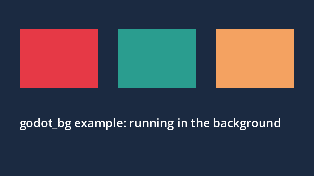

# godot-macos-bg-window

[English](README.md)

让 Godot 4 在 macOS 上**静默运行**：不出现 Dock 图标，不抢焦点，不在屏幕上弹出窗口，
同时照常渲染，仍可从 viewport 读取并保存截图。

适合在你正使用的笔记本上跑自动化测试、QA 或截图任务。平时每次 `godot --path ...`
打开窗口都会把焦点从你正在输入的程序抢走；这个工具就是用来消除这个问题的。

它是一个很小的 Objective-C 动态库，通过 `DYLD_INSERT_LIBRARIES` 只注入**一个** Godot
进程。不修改、不在磁盘上打补丁、也不重新签名 Godot。



## 原理

Godot 的 macOS 平台层在启动时会激活应用并显示窗口。注入的库在 `main` 之前替换少量
AppKit / Godot 方法：

| 目标 | 做法 |
| --- | --- |
| 永不成为前台应用 | 阻止 `activateApplication`、`activateIgnoringOtherApps:`、`activate`、`-[NSRunningApplication activateWithOptions:]`；激活策略固定为 `NSApplicationActivationPolicyProhibited`（无 Dock 图标、无菜单栏） |
| 永不可见 | 窗口位置固定为 `(-30000, -30000)`（含 `constrainFrameRect:toScreen:`，AppKit 无法把它拉回屏幕）；透明度 0；`ignoresMouseEvents` 为 `YES`；`sharingType` 为 `NSWindowSharingNone`；窗口集合行为加入 `Transient | IgnoresCycle` |
| 不接收键盘焦点 | `canBecomeKeyWindow` / `canBecomeMainWindow` 返回 `NO` |
| 继续渲染 | `-[NSWindow occlusionState]` 返回「可见」，Godot 不会因为窗口被遮挡而降低绘制 |
| 截图不受影响 | 不碰 viewport 的纹理读取，`get_viewport().get_texture().get_image()` 与未打补丁时像素一致 |

修改任何方法之前，库会先确认**所有**需要的方法都存在。若缺少（例如未来的 macOS 或 Godot
改了接口），就一个都不改，并报告 `active: false`，不会留下半套补丁。

成功后，库把 `{"active": true, "pid": <pid>}` 原子写入 `GODOT_BG_STATUS` 指定的文件。
`run.py` 等待这个文件，所以「补丁已加载」是被确认的，不是假设的。

## 要求

* macOS 12+（Apple 芯片或 Intel）
* Apple clang（`/usr/bin/clang`，随 Xcode 命令行工具安装）
* macOS 版 Godot 4.x。在 4.7.2 + Metal 上开发和验证；需要存在 `GodotApplication` /
  `GodotWindow` 类以及上表的方法
* 辅助脚本需要 Python 3.8+（仅标准库）

## 构建

```sh
python3 build.py        # 生成 godot_bg.dylib（arm64 + x86_64 通用）
```

`run.py` 在库缺失或比源码旧时会自动编译。

## 用法

```sh
python3 run.py [--godot=/path/to/godot] [选项] -- <godot 参数…>
```

`--` 之后的参数原样交给 Godot。Godot 可执行文件按以下顺序查找：`--godot`、`$GODOT`、
`PATH` 里的 `godot`、`/Applications/Godot.app/Contents/MacOS/Godot`。

```sh
# 后台运行一个工程
python3 run.py -- --path ~/my-game

# 运行脚本 / 场景，用第二个 `--` 传用户参数
python3 run.py --timeout 120 -- --path ~/my-game res://tests/shot.tscn -- /tmp/shot.png
```

选项：

| 选项 | 含义 |
| --- | --- |
| `--godot=PATH` | Godot 可执行文件 |
| `--allow-fallback` | 补丁无法编译或确认时，改为普通启动而不是失败（**可能抢焦点**） |
| `--timeout=SEC` | 超时后终止 Godot（退出码 124） |
| `--confirm-timeout=SEC` | 等待补丁确认的时间（默认 5 秒） |
| `--no-nice` | 不降低优先级（默认 `nice -n 10`） |
| `--lock=DIR` | Godot 运行期间持有一个原子 `mkdir` 锁，用于多个脚本之间串行化有窗口的运行 |

退出码：Godot 自身的退出码；`3` 表示补丁未生效（立刻结束 Godot，不会悄悄重启）；
`124` 超时；`130` 被中断。

关于启动命令（很容易写错）：

```
nice -n 10 /usr/bin/env DYLD_INSERT_LIBRARIES=<库> godot ...
```

`/usr/bin/nice` 受 SIP 保护，受 SIP 保护的程序会清掉环境里的 `DYLD_*`。让 `env` 在
`nice` 启动**之后**再设置变量，既保留优先级，又保留注入。同样的原因，SIP 保护的程序本身
无法注入。

### 跑示例

```sh
python3 run.py -- --path example -- "$PWD/shot.png"
```

`example/` 是一个最小的 Godot 4 工程：三个色块加一行文字，保存 640×360 的 viewport
截图后退出。应当看到 `[godot_bg] background patch loaded`，且没有窗口、Dock 图标或焦点变化。

### 验证补丁不改变渲染结果

用补丁开 / 关各截一张同一场景，再逐像素比较：

```sh
python3 run.py -- --path example -- "$PWD/on.png"          # 补丁开
godot --path example -- "$PWD/off.png"                      # 普通启动：会显示窗口并抢焦点
python3 compare.py on.png off.png --output compare.json     # 一致时退出码 0，"pass": true
```

`compare.py` 只用 Python 标准库：校验 PNG 的 CRC，支持非交错的 8 位 RGB/RGBA，比较尺寸与
全部 RGBA 像素（压缩方式或元数据不同不影响结论）。场景固定缩放到 640×360 的 viewport，
所以不同屏幕 DPI 也不影响。

### 验证焦点与窗口状态

```sh
python3 sample.py --output out-dir -- python3 run.py -- --path example -- "$PWD/shot.png"
```

`sample.py` 每 0.25 秒用 `osascript` 查询前台程序，补丁则在 Godot 进程内部记录真实的
`NSWindow` 属性（`GODOT_BG_SAMPLE_LOG`；不可共享的窗口在外部窗口列表里看不到）。只有命令
退出码为 0、窗口存在期间前台程序始终没变、且每个被采样的窗口都在屏幕外、透明、不接收鼠标、
不可共享时，`summary.json` 才算通过。运行期间请不要切换前台程序。`out-dir` 必须是新目录。

## 限制

* 只影响被注入的那个进程；其它 Godot 实例和你已打开的编辑器不受影响。
* 不修改也不重签 Godot。受 SIP 保护、或启用 hardened runtime 但没有
  `com.apple.security.cs.allow-dyld-environment-variables` 授权的程序会忽略
  `DYLD_INSERT_LIBRARIES`；此时 `run.py` 报告补丁未生效并退出（官网下载的 Godot 可用）。
* 依赖 Godot macOS 平台层的类名和方法名；未来的 Godot 或 macOS 可能让它失效，失效方式是
  「未生效」，不是崩溃。
* 窗口永远不可见，也无法点击或输入。需要人在窗口前操作，或需要真实可见、有焦点窗口的功能
  （原生对话框、部分输入路径）不适用。
* 仅在 Metal 渲染器上验证过，其它渲染器未测试。
* 外部工具（`screencapture`、屏幕共享）按设计看不到这个窗口；请像示例那样读取 viewport。
* 窗口靠移到屏幕外加透明度 0 隐藏。若注入被忽略，进程启动瞬间窗口服务器极少数情况下
  可能闪出窗口；`run.py` 一发现就会结束该进程。

## 致谢

Extracted from an indie game project's QA tooling.

## 许可证

[MIT](LICENSE)
